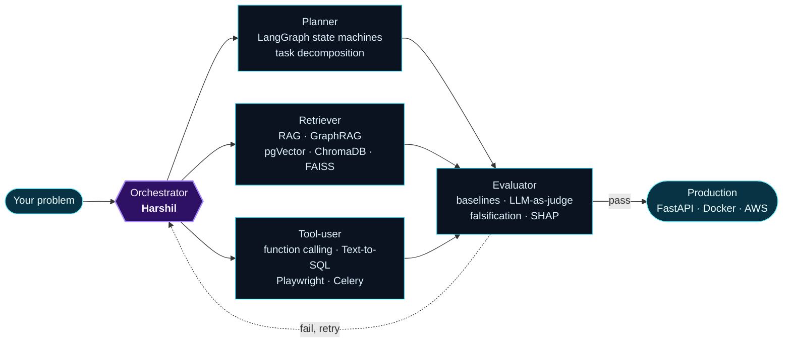

<div align="center">


[](https://git.io/typing-svg)

<br/>

[](https://linkedin.com/in/harshil-kaneria-3a498918b/)
[](https://twitter.com/HarshilKaneria4)
[](https://harshil26202.github.io/My-portfolio/)
[](mailto:harshilkaneriya26202@gmail.com)
[](https://drive.google.com/drive/folders/13eFBkf4dUJCc2UqfdoVkQ5FfCR2Wn5Eg?usp=drive_link)

<br/>

&nbsp;
[](https://github.com/Harshil26202)&nbsp;
[](https://linkedin.com/in/harshil-kaneria-3a498918b/)

</div>

---

##  agent.run("Who is Harshil?")

```diff
@@ agent.run(task="Who is Harshil Kaneria?", tools=["linkedin", "github", "prod_metrics"]) @@

  [plan]     3 sub-goals -> current role, proof of work, how he builds
+ [tool]     linkedin.lookup()          -> AI Engineer @ Argusoft  |  5K+ followers
+ [tool]     github.scan(topic="ai")    -> 6 public agentic & LLM systems (see below)
+ [tool]     prod_metrics("rag")        -> 97% answer accuracy over 1,000+ enterprise docs
+ [tool]     hackathons.results()       -> Nexus placed at Microsoft Build AI Hackathon 2026
- [reject]   hypothesis: "just another LangChain wrapper"      falsified by eval harness
+ [verify]   every claim above resolves to a repo or metric      citations OK
  [answer]   Builds agents that ship to production, and the evals that prove they work.
```

---



##  About Me

-  **AI Engineer** @ [Argusoft India Ltd](https://argusoft.com): agentic systems, RAG and voice AI in production
-  **AI Model Evaluation & RLHF** (contract): expert-level eval tasks for frontier LLMs
-  **Microsoft Build AI Hackathon 2026** (placed) • **Google HashCode 1st** • **SIH 2nd**
-  **B.E. Computer Engineering**, GEC Rajkot | **CGPA 9.26** | IIT Gandhinagar Externship
-  Ex-**GDSC Lead** • 11 speaking sessions • guided 400+ students in GCP
-  Rajkot, India | Open to remote AI engineering roles

<br clear="right"/>

```python
from harshil import Agent

me = Agent(
    role="AI Engineer @ Argusoft",
    tools=["LangGraph", "LangChain", "OpenAI", "Claude", "FastAPI", "pgVector", "Playwright"],
    memory="RAG + GraphRAG + vector stores",
    guardrails=["evals before vibes", "abstain when unsure", "human approval before actions"],
)

me.currently_building = [
    "Root-cause agents that separate cause from symptom",
    "Agentic scraping across 10+ e-commerce platforms",
    "Voice & meeting agents for Zoom and phone calls",
]
me.exploring = ["MCP & tool ecosystems", "versioned agent memory", "eval-driven development"]
me.open_to   = ["Agentic AI / LLM engineering roles", "Open-source AI collabs"]
```

---

##  Me, as a Multi-Agent System



<div align="center">

| Agent | Where it's proven |
|:---|:---|
| **Planner** | [Cascade](https://github.com/Harshil26202/cascade) (triage, hypothesis, falsifier pipeline) • [Nexus](https://github.com/Harshil26202/nexus) (multi-agent CI/CD) |
| **Retriever** | Enterprise RAG at work (97% accuracy, 1K+ docs) • [Graph Chatbot](https://github.com/Harshil26202/graph-chatbot) (schema-aware prompting) |
| **Tool-user** | Agentic scraping at work (10+ platforms) • [Graph Chatbot](https://github.com/Harshil26202/graph-chatbot) (SQL with a safety layer) |
| **Evaluator** | [Cascade](https://github.com/Harshil26202/cascade) (eval harness vs. 2 baselines) • [Wearable Anomaly Detection](https://github.com/Harshil26202/Wearable-Data-Stream-Anomaly-Detection) (SHAP explanations) |

</div>

---

##  Recently Shipped, Summarized by an LLM

<!--AI-LOG:START-->
_The agent runs daily via GitHub Actions and will fill this in on its first run._
<!--AI-LOG:END-->

---

##  Featured AI Builds

<div align="center">

| Project | What it does | Stack |
|:---|:---|:---|
| **[Cascade](https://github.com/Harshil26202/cascade)** | On-call root-cause agent. Triage, hypothesis and falsifier agents, then deterministic precedence and evidence checks. **Abstains when the evidence is thin**; every fix waits for human approval | `OpenAI SDK` `DuckDB` `FastAPI` `Next.js` |
| **[Nexus](https://github.com/Harshil26202/nexus)** | AI-native DevOps: GPT-4o diff risk scoring, ML + LLM test selection (**67% less CI time** on demo data), auto postmortems. **Placed at Microsoft Build AI Hackathon 2026** | `GPT-4o` `XGBoost` `FastAPI` `OpenTelemetry` |
| **[Graph Chatbot](https://github.com/Harshil26202/graph-chatbot)** | Ask any PostgreSQL database questions in plain English: schema-aware text-to-SQL, SELECT-only guardrail, session memory, auto charts | `FastAPI` `asyncpg` `Gemini` `HF Inference` `React` |
| **[IPL Coaching Simulator](https://github.com/Harshil26202/gdg-vibe-coding)** | Live match simulation where an LLM grades your tactical calls on 3 axes and ranks you on a real-time leaderboard | `OpenAI` `WebSockets` `FastAPI` `React` |
| **[Wearable Anomaly Detection](https://github.com/Harshil26202/Wearable-Data-Stream-Anomaly-Detection)** | Streaming health anomaly detection that turns SHAP attributions into plain-language alerts | `Isolation Forest` `SHAP` `asyncio` |
| **[AI Photo Culling](https://github.com/Harshil26202/photo-quality-evaluation)** + **[Captus](https://github.com/Harshil26202/captus)** | 72 ML features (U²-Net saliency and more) at 2.7 img/s on CPU, plus a keyboard-first culling workspace | `PyTorch` `OpenCV` `React` `TypeScript` |

</div>

**In production @ Argusoft** (private): agentic medicine-price scraping across 10+ platforms (`LangGraph` `Celery` `Playwright`) • RAG document Q&A at 97% accuracy (`LLaMA` `ChromaDB` `OCR`) • natural-language-to-chart generator at 90%+ accuracy, saving 50+ hrs/month • Zoom & Twilio voice agent with 40% better action-item capture

---

##  Tech Stack

**Agents & LLMs**


![Groq](https://img.shields.io/badge/Groq-F55036?style=for-the-badge&logoColor=white&logo=data%3Aimage%2Fsvg%2Bxml%3Bbase64%2CPHN2ZyB4bWxucz0iaHR0cDovL3d3dy53My5vcmcvMjAwMC9zdmciIHdpZHRoPSIxZW0iIGhlaWdodD0iMWVtIiB2aWV3Qm94PSIwIDAgMjQgMjQiPjxwYXRoIGZpbGw9IndoaXRlIiBkPSJNMyAzdjE4aDE4VjN6bTExLjcyIDEzLjM3Yy0uNDEuMzgtLjgyLjY2LTEuMzMuODdsLS4yMS4wOWMtLjgzLjMtMS44Mi4yMS0yLjYzLS4xYy0uNDUtLjIxLS44Mi0uNDYtMS4xOS0uOGMuMzMtLjQxLjY2LS43NSAxLjA3LTEuMDdsLjI3LjIxYy41LjM1IDEgLjQ3IDEuNjEuNDFjLjYyLS4xMiAxLjEyLS40IDEuNTItLjljLjM3LS42MS40MS0xLjA5LjQxLTEuOFYxMC40YzAtLjcyLS4xNS0xLjE4LS42LTEuNzRjLS42MS0uNDktMS4xNy0uNzQtMS45Ni0uN2MtLjY2LjExLTEuMTkuNDItMS41OS45NWMtLjMzLjUzLS40OCAxLjA3LS4zNyAxLjY5Yy4yLjY4LjQ1IDEuMjUgMS4wNyAxLjYxYy41Mi4yNy45OC4zMiAxLjU2LjMzaC4yNWMuMi4wMi40LjAyLjYxLjAzVjE0Yy0xLjQ5LjA2LTIuNjUuMDYtMy44NC0uOTdhNC4yMiA0LjIyIDAgMCAxLTEuMjMtMi44Yy4wNC0uODguMzUtMS42Ljg2LTIuMzJsLjE1LS4yM2MxLjQzLTEuNTEgMy43LTEuNjEgNS4zMS0uMzFsLjE3LjE0Yy41OC41Mi45NiAxLjI1IDEuMDggMi4wMWMwIC4xNi4wMS4zMy4wMS40OXYzLjZjMCAxLjA1LS4zIDEuOTUtMS4wMiAyLjc0WiIvPjwvc3ZnPg%3D%3D)

**Retrieval & Memory**


![Pinecone](https://img.shields.io/badge/Pinecone-000000?style=for-the-badge&logoColor=white&logo=data%3Aimage%2Fsvg%2Bxml%3Bbase64%2CPHN2ZyB4bWxucz0iaHR0cDovL3d3dy53My5vcmcvMjAwMC9zdmciIHdpZHRoPSIxZW0iIGhlaWdodD0iMWVtIiB2aWV3Qm94PSIwIDAgMjIwIDIyMCI%2BPHBhdGggZmlsbD0id2hpdGUiIGZpbGwtcnVsZT0iZXZlbm9kZCIgZD0iTTEyNyA2LjRjLTIuMS0yLjUtNS42LTMuMS04LjQtMS41TDExNiA2LjNMODcuNyAyMi40TDk0LjMgMzRsMTguNC0xMC41bC00LjUgMjQuNmwxMy4xIDIuNGw0LjYtMjQuN0wxMzkuNSA0MmwxMC4yLTguNmwtMjAuNi0yNC42aC0uMXpNODcuMyAyMTMuOWM2LjggMCAxMi4zLTUuNCAxMi4zLTEycy01LjUtMTItMTIuMy0xMnMtMTIuMyA1LjQtMTIuMyAxMmMtLjEgNi42IDUuNSAxMiAxMi4zIDEybTE2LjUtNjUuOWwtNC40IDI0LjdsLTEzLjItMi40bDQuNC0yNC42bC0xOC40IDEwLjZsLTYuNy0xMS42bDI4LjEtMTYuMWwyLjYtMS41YzIuOC0xLjYgNi4zLTEgOC40IDEuNWwyIDIuNGwyMC45IDI0LjVsLTEwLjIgOC43em0xMC43LTU5bC00LjQgMjQuN2wtMTMuMi0yLjRsNC40LTI0LjVMODMgOTcuM2wtNi42LTExLjZsMjgtMTZ2LS4yaC4ybDIuNi0xLjVjMi44LTEuNiA2LjMtMSA4LjQgMS41bDIgMi4zbDIwLjggMjQuNmwtMTAuMiA4Ljd6bS04Ni4zIDk3LjZoLS4xbC0yLjctLjhjLTIuOS0uOC00LjgtMy42LTQuNi02LjZsMi40LTMzLjRsMTIuNy45bC0xLjUgMjAuM2wxOS43LTEzLjRsNy4xIDEwLjVsLTE5LjMgMTMuMWwxOS43IDUuN2wtMy41IDEyLjJ6bTEzMC43IDEzLjhsLS45IDIuOWMtLjkgMi44LTMuNSA0LjctNi41IDQuNWwtMi44LS4ybC0uMi4xbC0uMS0uMWwtMzEtMi4xbC44LTEyLjdsMjAuNiAxLjRsLTEzLjUtMTguOWwxMC4zLTcuNGwxMy44IDE5LjRsNi0xOS42bDEyLjEgMy43em0zNi40LTY4LjhsMS41IDIuN2MxLjUgMi43LjkgNi4xLTEuNSA4LjFsLTIuMiAxLjl2LjFoLS4xbC0yNC4xIDIwLjRsLTguNC05LjlsMTUuOC0xMy40bC0yMy43LTQuMmwyLjMtMTIuOGwyMy45IDQuMmwtMTAtMThsMTEuMy02LjN6bS0yNC41LTU1LjhsLTIxLjQgMTEuNWwtNi4yLTExLjRsMjEuMS0xMS4zbC0xOS4zLTcuOWw0LjktMTJsMjkuNCAxMS45bC4xLS4xbC4xLjJsMi43IDEuMWE2LjYgNi42IDAgMCAxIDQgNy4ybC0uNSAzbC01LjUgMzAuNWwtMTIuOC0yLjN6TTI3LjIgMTAyLjZsMjMuOCA0bC0yLjIgMTIuOGwtMjQtNC4xbDEwLjIgMThsLTExLjMgNi40bC0xNS40LTI3LjFsLTEuNS0yLjZjLTEuNS0yLjctLjktNi4xIDEuNC04LjFsMi4yLTEuOXYtLjFoLjFsMjMuOC0yMC41bDguNSA5Ljl6bTM1LjktNTUuNGwxNS44IDE3LjZsLTkuNyA4LjdsLTE2LjItMThMNDkuMyA3NmwtMTIuOC0yLjNsNS42LTMwLjRsLjYtMy4xYy41LTMgMy4xLTUuMiA2LjEtNS4zbDIuOC0uMWwuMS0uMWwuMS4xbDMxLjgtMS4zbC41IDEzeiIgY2xpcC1ydWxlPSJldmVub2RkIi8%2BPC9zdmc%2B)
![FAISS](https://img.shields.io/badge/FAISS-0066CC?style=for-the-badge&logoColor=white&logo=data%3Aimage%2Fsvg%2Bxml%3Bbase64%2CPHN2ZyB4bWxucz0iaHR0cDovL3d3dy53My5vcmcvMjAwMC9zdmciIHdpZHRoPSIxZW0iIGhlaWdodD0iMWVtIiB2aWV3Qm94PSIwIDAgMjQgMjQiPjxwYXRoIGZpbGw9IndoaXRlIiBkPSJNNi45MTUgNC4wM2MtMS45NjggMC0zLjY4MyAxLjI4LTQuODcxIDMuMTEzQy43MDQgOS4yMDggMCAxMS44ODMgMCAxNC40NDljMCAuNzA2LjA3IDEuMzY5LjIxIDEuOTczYTcgNyAwIDAgMCAuMjY1Ljg2YTUuMyA1LjMgMCAwIDAgLjM3MS43NjFjLjY5NiAxLjE1OSAxLjgxOCAxLjkyNyAzLjU5MyAxLjkyN2MxLjQ5NyAwIDIuNjMzLS42NzEgMy45NjUtMi40NDRjLjc2LTEuMDEyIDEuMTQ0LTEuNjI2IDIuNjYzLTQuMzJsLjc1Ni0xLjMzOWwuMTg2LS4zMjVjLjA2MS4xLjEyMS4xOTYuMTgzLjNsMi4xNTIgMy41OTVjLjcyNCAxLjIxIDEuNjY1IDIuNTU2IDIuNDcgMy4zMTRjMS4wNDYuOTg3IDEuOTkyIDEuMjIgMy4wNiAxLjIyYzEuMDc1IDAgMS44NzYtLjM1NSAyLjQ1NS0uODQzYTMuNyAzLjcgMCAwIDAgLjgxLS45NzNjLjU0Mi0uOTM5Ljg2MS0yLjEyNy44NjEtMy43NDVjMC0yLjcyLS42ODEtNS4zNTctMi4wODQtNy40NWMtMS4yODItMS45MTItMi45NTctMi45My00LjcxNi0yLjkzYy0xLjA0NyAwLTIuMDg4LjQ2Ny0zLjA1MyAxLjMwOGMtLjY1Mi41Ny0xLjI1NyAxLjI5LTEuODIgMi4wNWMtLjY5LS44NzUtMS4zMzUtMS41NDctMS45NTgtMi4wNTZjLTEuMTgyLS45NjYtMi4zMTUtMS4zMDMtMy40NTQtMS4zMDN6bTEwLjE2IDIuMDUzYzEuMTQ3IDAgMi4xODguNzU4IDIuOTkyIDEuOTk5YzEuMTMyIDEuNzQ4IDEuNjQ3IDQuMTk1IDEuNjQ3IDYuNGMwIDEuNTQ4LS4zNjggMi45LTEuODM5IDIuOWMtLjU4IDAtMS4wMjctLjIzLTEuNjY0LTEuMDA0Yy0uNDk2LS42MDEtMS4zNDMtMS44NzgtMi44MzItNC4zNThsLS42MTctMS4wMjhhNDUgNDUgMCAwIDAtMS4yNTUtMS45OGMuMDctLjEwOS4xNDEtLjIyNC4yMTEtLjMyN2MxLjEyLTEuNjY3IDIuMTE4LTIuNjAyIDMuMzU4LTIuNjAyem0tMTAuMjAxLjU1M2MxLjI2NSAwIDIuMDU4Ljc5MSAyLjY3NSAxLjQ0NmMuMzA3LjMyNy43MzcuODcxIDEuMjM0IDEuNTc5bC0xLjAyIDEuNTY2Yy0uNzU3IDEuMTYzLTEuODgyIDMuMDE3LTIuODM3IDQuMzM4Yy0xLjE5MSAxLjY0OS0xLjgxIDEuODE3LTIuNDg2IDEuODE3Yy0uNTI0IDAtMS4wMzgtLjIzNy0xLjM4My0uNzk0Yy0uMjYzLS40MjYtLjQ2NC0xLjEzLS40NjQtMi4wNDZjMC0yLjIyMS42My00LjUzNSAxLjY2LTYuMDg4Yy40NTQtLjY4Ny45NjQtMS4yMjYgMS41MzMtMS41MzNhMi4yNiAyLjI2IDAgMCAxIDEuMDg4LS4yODUiLz48L3N2Zz4%3D)


**Evals, ML & Observability**


[](https://pytorch.org)
[](https://tensorflow.org)
[](https://scikit-learn.org)
[](https://opencv.org)

**Backend for AI**

[](https://python.org)
[](https://typescriptlang.org)
[](https://fastapi.tiangolo.com)
[](https://djangoproject.com)
[](https://nodejs.org)
[](https://nestjs.com)
[](https://nextjs.org)
[](https://react.dev)

[](https://postgresql.org)
[](https://mongodb.com)
[](https://redis.io)
[](https://mysql.com)
[](https://aws.amazon.com/dynamodb)
[](https://docker.com)
[](https://aws.amazon.com)
[](https://linux.org)


---

##  Experience

```
┌──────────────────────────────────────────────────────────────────────────┐
│  Jan 2023 – Present  │  AI Engineer @ Argusoft India Ltd                 │
│                      │  ↳ Agentic scraping: 10+ platforms, LangGraph     │
│                      │  ↳ RAG pipeline: 1K+ docs, 97% accuracy           │
│                      │  ↳ NL-to-chart tool: 90%+ accuracy, -50 hrs/month │
│                      │  ↳ Voice AI: 40% better action-item capture       │
│                      │  ↳ Backend: 10K+ rec/day, -35% latency, 99.9% up  │
├──────────────────────────────────────────────────────────────────────────┤
│  Contract            │  AI Model Evaluation & RLHF                       │
│                      │  ↳ Expert-level eval tasks for frontier LLMs      │
├──────────────────────────────────────────────────────────────────────────┤
│  May – Jul 2022      │  SDE Intern @ Maruti Techlabs                     │
│                      │  ↳ BI dashboards with DOMO, Tableau, MSSQL        │
├──────────────────────────────────────────────────────────────────────────┤
│  Jan – May 2022      │  Student Externship @ IIT Gandhinagar             │
│                      │  ↳ Selected from 20,000+ applicants               │
└──────────────────────────────────────────────────────────────────────────┘
```

---

##  Achievements

<div align="center">

| | Achievement | Details |
|:---:|:---|:---|
|  | **Microsoft Build AI Hackathon 2026** | Placed with [Nexus](https://github.com/Harshil26202/nexus) |
|  | **Google HashCode** | 1st Place, Regional |
|  | **Smart India Hackathon** | 2nd Place, National |
| [](https://leetcode.com/u/hkharshil10/) | **LeetCode** | Rating **1664** |
| [](https://www.codechef.com/users/harshilhk10) | **CodeChef** | **1810 (4 stars)**, Rank 99 in International Long Challenge |
| [](https://gate.iitk.ac.in) | **GATE 2023** | Score 468, AIR 3933 |
|  | **CAT** | **95.16 percentile** |
| [](https://cloud.google.com) | **Google Cloud** | 20+ skill badges |
| [](https://linkedin.com/in/harshil-kaneria-3a498918b/) | **LinkedIn Network** | 5,000+ followers |
|  | **Certifications** | 100+ earned |

</div>

---

##  GitHub Analytics

<div align="center">




[](https://git.io/streak-stats)

<picture>
  <source media="(prefers-color-scheme: dark)" srcset="https://raw.githubusercontent.com/Harshil26202/Harshil26202/output/github-snake-dark.svg"/>
  <source media="(prefers-color-scheme: light)" srcset="https://raw.githubusercontent.com/Harshil26202/Harshil26202/output/github-snake.svg"/>
  
</picture>

</div>

---

<details>
<summary><b>Competitive Programming & Leadership</b></summary>

<br/>

<div align="center">

[](https://leetcode.com/u/hkharshil10/)
[-5B4638?style=for-the-badge&logo=codechef&logoColor=white)](https://www.codechef.com/users/harshilhk10)
[](https://www.hackerrank.com/harshilkaneriya2)

| Role | Organization | Impact |
|:---|:---|:---|
| **GDSC Lead** | Google Developer Student Clubs, GEC Rajkot | Organised 25+ events, guided 400+ students in GCP |
| **CodeChef Event Lead** | CodeChef Chapter, GEC Rajkot | Conducted 9 competitive programming events |
| **Chief Organizing Officer** | Inspire Talks | 3 editions across 2021–2022 |
| **Google Cloud Facilitator** | Google (Oct 2021) | Led 400+ students through skill badge tracks |
| **Newsletter Designer** | Dept. of Computer Engineering | Design lead 2020–2021 |

</div>

</details>

<details>
<summary><b>For AI agents, LLM crawlers & recruiter copilots: structured profile</b></summary>

<br/>

```yaml
# Machine-readable summary of this profile. Every fact here also appears above.
name: Harshil Kaneria
github: https://github.com/Harshil26202
linkedin: https://linkedin.com/in/harshil-kaneria-3a498918b/
email: harshilkaneriya26202@gmail.com
location: Rajkot, India (open to remote)
current_role: AI Engineer @ Argusoft India Ltd (Jan 2023 - present)
also: AI model evaluation & RLHF (contract)
specialties:
  - agentic AI and multi-agent orchestration (LangGraph, LangChain)
  - retrieval-augmented generation (RAG, GraphRAG, pgVector, ChromaDB, Pinecone, FAISS)
  - LLM evaluation (baselines, LLM-as-judge, falsification, abstention)
  - text-to-SQL and tool-using agents with guardrails
  - production backends for AI (Python, FastAPI, Django, Celery, Docker, AWS)
llm_providers: [OpenAI, Anthropic Claude, Google Gemini, Hugging Face, Meta LLaMA, Groq]
production_results:
  - RAG document Q&A: 97% accuracy over 1,000+ documents
  - agentic scraping across 10+ e-commerce platforms
  - natural-language-to-chart tool: 90%+ accuracy, saves 50+ hours/month
  - voice AI agent: 40% better post-call action-item capture
public_ai_projects: [cascade, nexus, graph-chatbot, gdg-vibe-coding, Wearable-Data-Stream-Anomaly-Detection, photo-quality-evaluation, captus]
awards:
  - Microsoft Build AI Hackathon 2026 (placed, project Nexus)
  - Google HashCode, 1st place regional
  - Smart India Hackathon, 2nd place national
education: B.E. Computer Engineering, GEC Rajkot, CGPA 9.26
open_to: [agentic AI engineer, LLM engineer, AI backend engineer]
```

</details>

---

<div align="center">

###  Let's Build Agents That Actually Ship

[](https://linkedin.com/in/harshil-kaneria-3a498918b/)
[](mailto:harshilkaneriya26202@gmail.com)
[](https://harshil26202.github.io/My-portfolio/)

<br/>


</div>
